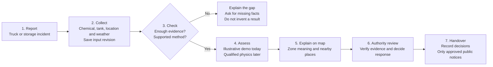
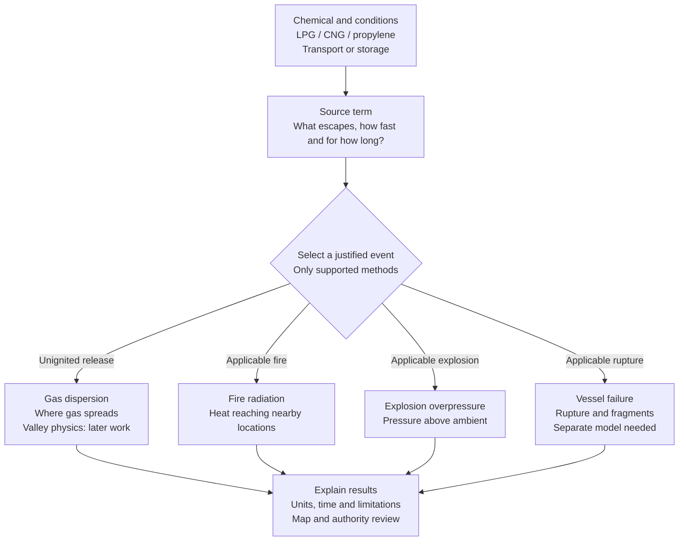
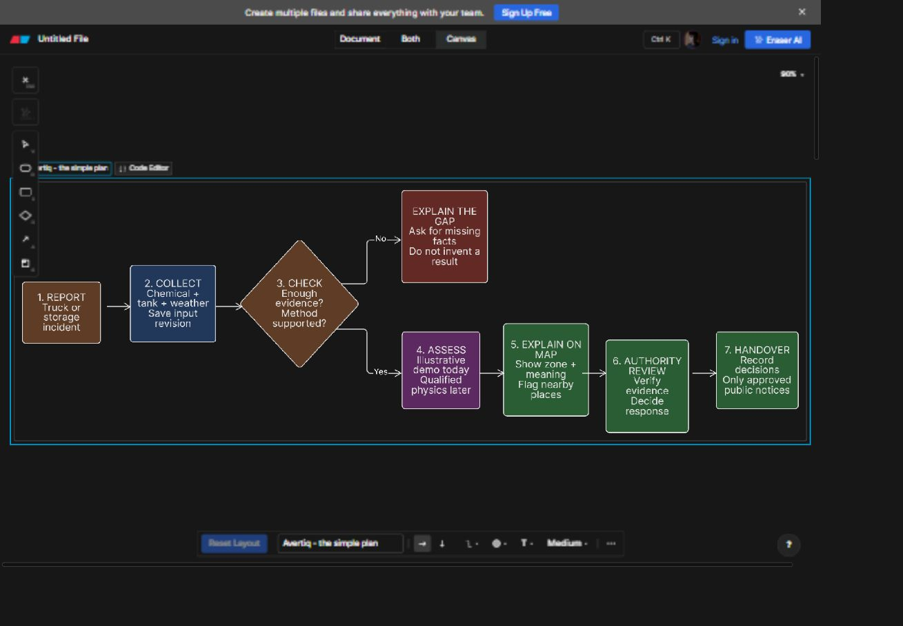

# Avertiq workflow for a mentor walkthrough

**11 November implementation update:** the first local incident backend now exists. The diagrams remain the intended full workflow; see the [backend milestone](BACKEND_MILESTONE.md) for saved inputs, jobs/history and current limits. References below to planned backend/browser-only storage describe the earlier mentor planning baseline.

10 November 2026. This is the planned workflow, with the implemented demo clearly separated from future backend and qualified physics. It does not authorise operational emergency use.

Saved in Eraser and added to GitHub on 11 November 2026: [Avertiq - Incident Workflow and Physics Plan](https://app.eraser.io/workspace/Q7ganj2xg2MLvDhdt4tt). The current Eraser link permits editing with an Eraser account. This GitHub document provides a versioned copy to read and discuss.

## The seven-step plan

New evidence restarts at step 2 with a new revision; retain the previous inputs and mark their assessment stale. Failed or unsupported runs return an explanation, not a success zone. Nearby places require review; the map does not automatically order evacuation or establish a safe route.

## Where physics fits: step 4

These are **future calculation branches**, subject to supported methods and suitable evidence. Not every accident activates every branch.

Missing inputs or unsupported conditions block a prediction. Gas buoyancy depends on release conditions as well as chemical identity. A visual 3D map is not a valley-flow model, and the independent research is not field validated.

## Diagrams

The diagrams were simplified after the user found the first version too complex. Start with the seven-step overview; open the physics diagram only when explaining step 4. Detailed backend responsibilities remain in the backend workflow document rather than on the presentation canvas.

The diagrams above use Mermaid for GitHub display. The editable Eraser sources use **Eraser Flow Chart DSL**:

- [Accident-to-response overview](diagrams/incident-workflow.eraser)
- [Where the physics fits](diagrams/physics-detail.eraser)

In Eraser, choose **Insert > Diagram as Code > Flow Chart**, then replace the example code with one source file. Use two diagrams so the overview stays readable. Blue covers data/backend steps, purple covers physics, orange covers gates/demo/updates and green covers interpretation/review. The text labels carry status; colour alone does not imply readiness.

## A two-minute explanation

“Suppose a tanker is damaged. We first record what is actually reported, which chemical it carries and what remains unknown. Damage alone does not prove a leak, fire or explosion. Every input is labelled as reported, measured, assumed or missing.

“The planned backend saves a frozen input revision. It checks whether the information is sufficient and whether a model can handle that chemical, release state and scenario. If it cannot, the website explains the missing information instead of drawing a prediction.

“Physics first describes what escapes from the tank. Depending on the evidence, a supported calculation could then estimate gas dispersion, heat radiation from an applicable fire, or overpressure from an applicable explosion. Mechanical rupture is a separate branch. Valley-dependent dispersion needs additional terrain-aware physics; showing hills on a map is not that calculation.

“The dashboard will explain the result alongside the map: what was used, what the zone means and what the limitations are. Nearby places are flagged for review. Authorities decide response actions and approve public communication. New information creates another revision, retaining the old one but preventing its result being mistaken for the current assessment.

“Today we have a browser-local demonstration with illustrative A/B zones and separate physics research. The next build is the persistent incident-to-assessment workflow, initially using an honestly labelled demo adapter. Qualified physics is connected only after its checks pass.”

## Short glossary

| Term | Meaning in this project |
|---|---|
| Incident | One reported truck or storage event, with evolving evidence. |
| Asset | The tanker, cylinder bank or storage vessel involved. |
| Evidence / provenance | Where a value came from, who reported it and when; assumptions stay visible. |
| Input revision | An immutable snapshot of the data used for one assessment; later edits create another revision. |
| Backend / API | Server logic and the interface through which the dashboard saves data and requests work; incident assessment services are planned. |
| Database | Persistent incident, revision, job and result records; current incident state is browser-local. |
| Source term | What enters the environment: material, phase, rate, temperature, direction and duration/time history. |
| Phase | Whether material is gas, liquid or a two-phase mixture; it affects release behaviour. |
| Model adapter | A controlled bridge between our workflow and a specific model, including applicability and output checks. |
| Applicability | Whether the method supports this chemical, state, geometry, weather and scenario. |
| Assessment job | A tracked calculation request associated with one exact revision. |
| Dispersion | Gas spreading, mixing and changing concentration over space and time. |
| Buoyancy | Density differences that influence rising or slumping; conditions matter as well as chemical identity. |
| Thermal radiation | Heat reaching a receiver from a fire; not the same as radioactive radiation. |
| Overpressure | Pressure above ambient from an eligible explosion scenario; a contour needs a defined pressure threshold. |
| BLEVE | Boiling liquid expanding vapour explosion: a conditional pressurised-vessel failure scenario; a fireball requires appropriate combustible/ignition conditions. |
| Terrain-aware model | A calculation that represents terrain effects on flow/transport; different from visual 3D terrain. |
| Contour / threshold | A boundary for a specified quantity and level, with units and time/averaging basis; not a universal danger or safety boundary. |
| Stale result | An older result whose inputs no longer match the current revision. |
| Verification | Checking the mathematics and numerical implementation. |
| Validation | Comparing a model with appropriate physical measurements for a defined use; synthetic tests are not field validation. |
| Handover | A readable record of evidence, assumptions, assessment status, decisions and open questions. |

## Status and next build

| Area | Status |
|---|---|
| D-001 dashboard, map, synthetic observations, illustrative A/B history and browser exports | Implemented demo; edits invalidate the fixture overlay. Nearby demo places are fictional. |
| Python source/flow research | Independent research, not connected to the dashboard or field validated; not a complete LPG/CNG/propylene service. |
| Incident API, persistent database, immutable server revisions and tracked jobs | Planned next software milestone. |
| Production dispersion, fire radiation, explosion and valley calculations | Require supported methods, applicability checks and suitable reference/validation evidence. |
| Agency accounts, live telemetry, dispatch and public alert delivery | Future requirements and integrations; no live connection exists today. |

First build: **one incident -> saved input revision -> checks -> tracked job -> labelled demo result -> explanation/map -> handover**. Prove persistence, revision history, blocking reasons and stale-result handling before adding one qualified physics adapter.

Chemical focus is LPG, CNG and propylene; no fourth chemical is confirmed. Do not silently treat LPG as pure propane or CNG as pure methane. No verified historical accident location or tanker measurements are asserted by this scenario.

See the [backend workflow](BACKEND_WORKFLOW.md), [assessment contract](ASSESSMENT_CONTRACT.md), [chemical/storage scope](research/CHEMICAL_AND_STORAGE_SCOPE.md) and [physics requirements](research/PHYSICS_REQUIREMENTS.md) for the detailed basis. Eraser syntax reference: [official Flow Chart documentation](https://docs.eraser.io/flow-chart-syntax).
